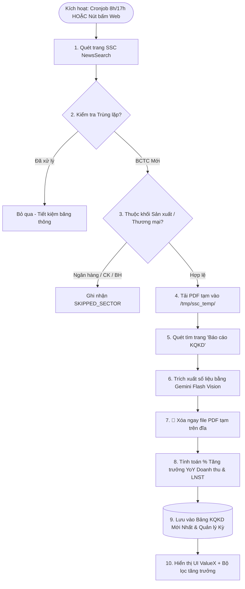

# Kế hoạch & Danh sách Task: Tự động Thu thập & Số hóa BCTC từ UBCKNN (SSC)

## 📌 Tổng Quan Dự Án
Xây dựng module và skill tự động hóa tích hợp trong nền tảng **ValueX**:
1. **Thu thập tin tức**: Tự động quét trang công bố thông tin của UBCKNN (`https://congbothongtin.ssc.gov.vn/faces/NewsSearch`) để lấy các bản công bố Báo cáo tài chính (BCTC) mới nhất.
2. **Chống trùng lặp (Deduplication)**: Nhận diện các báo cáo đã tải/xử lý để bỏ qua, không lãng phí thời gian và tài nguyên CPU/mạng.
3. **Lọc ngành tập trung**: Tạm thời chỉ xử lý các doanh nghiệp thuộc khối Sản xuất, Thương mại và Dịch vụ; loại trừ Ngân hàng, Chứng khoán, Bảo hiểm.
4. **Định vị & Số hóa Báo cáo KQKD**: Tìm đúng trang có bảng *"Báo cáo kết quả hoạt động kinh doanh"*, đọc các chỉ tiêu chuẩn (Doanh thu thuần, Giá vốn, Lợi nhuận gộp, Lợi nhuận sau thuế) cùng kỳ này & cùng kỳ năm trước (ngay trong 1 trang hoặc tràn sang trang kế tiếp). Hỗ trợ nhận diện kỳ Quý (Q1-Q4) hoặc 6 Tháng.
5. **Tiết kiệm tài nguyên (Auto-cleanup)**: Xóa ngay file PDF trên đĩa tạm sau khi số hóa thành công vào bảng dữ liệu.
6. **Bảng "Cập nhật kết quả kinh doanh mới nhất"**: Lưu trữ dữ liệu số hóa, tự động tính % tăng trưởng YoY Doanh thu & LNST; quản lý phân kỳ rõ ràng và có cơ chế rollover/làm mới khi bước sang kỳ công bố mới.
7. **Cơ chế kích hoạt linh hoạt**:
   - **Tự động**: Cronjob định kỳ lúc **08:00** và **17:00** hàng ngày trên VPS.
   - **Thủ công**: Nút bấm *"Quét BCTC mới"* trên giao diện ValueX để kiểm tra ngay lập tức các trang mới nhất.

---

## 🏗️ Kiến Trúc Luồng Xử Lý (Pipeline Architecture)



---

## 📋 Danh Sách Task Triển Khai Chi Tiết

### Phase 1: Nền tảng Dữ liệu, Manifest Chống trùng & Bộ lọc Ngành

#### Task 1.1: Định nghĩa Types & Contracts cho Module KQKD
- **Mô tả**: Tạo file kiểu dữ liệu chuẩn `src/types/earnings.ts` cho các bản ghi kết quả kinh doanh, trạng thái cào tin và manifest theo dõi.
- **Acceptance criteria**:
  - [ ] Khai báo interface `EarningsRecord` (mã CP, tên cty, sàn, kỳ báo cáo, năm, doanh thu kỳ này/cùng kỳ/YoY, LNST kỳ này/cùng kỳ/YoY, biên lãi gộp, ngày công bố, nguồn).
  - [ ] Khai báo interface `CrawlManifestItem` (reportKey, ticker, title, publishDate, pdfUrl, status, processedAt).
  - [ ] Định nghĩa Enum kỳ báo cáo: `Q1` | `Q2` | `Q3` | `Q4` | `6T` | `NAM`.
- **Files**: `src/types/earnings.ts`
- **Scope**: S (1 file)

#### Task 1.2: Xây dựng Manifest Engine chống trùng lặp
- **Mô tả**: Xây dựng service `src/lib/ssc-manifest-store.ts` để đọc/ghi lịch sử các báo cáo đã xử lý, hỗ trợ lưu trữ cục bộ (JSON file) hoặc Supabase.
- **Acceptance criteria**:
  - [ ] Hàm `getProcessedKeys()` trả về danh sách/Set các mã báo cáo đã tải.
  - [ ] Hàm `isReportProcessed(reportKey)` kiểm tra cực nhanh xem báo cáo đã từng xử lý chưa.
  - [ ] Hàm `markReportStatus(item: CrawlManifestItem)` lưu trạng thái `PROCESSED`, `SKIPPED_SECTOR`, hoặc `FAILED`.
- **Files**: `src/lib/ssc-manifest-store.ts`
- **Scope**: S (1 file)

#### Task 1.3: Crawler lấy tin tức từ SSC & Bộ lọc loại trừ ngành tài chính
- **Mô tả**: Xây dựng service `src/lib/ssc-crawler-service.ts` để gửi request tới `https://congbothongtin.ssc.gov.vn/faces/NewsSearch`, phân tích HTML bảng tin, lọc bài viết chứa từ khóa *"Báo cáo tài chính"*.
- **Acceptance criteria**:
  - [ ] Hỗ trợ cào N trang mới nhất (mặc định 1 - 3 trang cho cronjob hàng ngày).
  - [ ] Lọc bỏ ngay lập tức các mã Ngân hàng, Chứng khoán, Bảo hiểm theo danh sách ticker cố định.
  - [ ] Kiểm tra trùng lặp với Manifest để chỉ trả về danh sách các link PDF mới cần xử lý.
- **Files**: `src/lib/ssc-crawler-service.ts`
- **Scope**: M (2 files)

---

### Checkpoint 1: Xác nhận Crawler & Deduplication
- [ ] Chạy thử cào 1 trang từ SSC: Lấy được danh sách tin BCTC mới.
- [ ] Chạy lại lần 2: Hệ thống nhận diện 100% tin đã có trong Manifest và bỏ qua mà không xử lý lại.
- [ ] Kiểm tra các mã như VCB, SSI, BVH được gắn nhãn `SKIPPED_SECTOR` chính xác.

---

### Phase 2: Tải PDF Tạm, Định vị Trang KQKD & Số Hóa Gemini

#### Task 2.1: Bộ định vị trang KQKD (PDF Page Locator) & Xóa tệp tự động
- **Mô tả**: Xây dựng service `src/lib/ssc-pdf-locator.ts` tải file về thư mục đệm `/tmp/ssc_temp/`, sử dụng `pdf-parse` để quét tìm trang chứa tiêu đề *"Báo cáo kết quả hoạt động kinh doanh"*.
- **Acceptance criteria**:
  - [ ] Tải file PDF an toàn kèm timeout và kiểm tra tính hợp lệ (> 1KB).
  - [ ] Quét text tìm trang tiêu đề: `BÁO CÁO KẾT QUẢ HOẠT ĐỘNG KINH DOANH`.
  - [ ] Kiểm tra nếu các chỉ tiêu cốt lõi (như *"Lợi nhuận sau thuế"*) nằm ở trang tiếp theo thì gộp cả 2 trang (Trang N và N+1).
  - [ ] Hàm dọn dẹp `cleanupTempPdf(filePath)` tự động xóa file PDF gốc ngay sau khi hoàn thành.
- **Files**: `src/lib/ssc-pdf-locator.ts`
- **Scope**: M (2 files)

#### Task 2.2: Trích xuất số liệu chuẩn hóa bằng Gemini Flash Vision
- **Mô tả**: Xây dựng module `src/lib/ssc-earnings-extractor.ts` gửi nội dung/ảnh của 1-2 trang KQKD vào Gemini Flash API với Structured JSON Schema để lấy số liệu kỳ này và cùng kỳ.
- **Acceptance criteria**:
  - [ ] Prompt ép schema nghiêm ngặt: Doanh thu thuần, Giá vốn, Lợi nhuận gộp, Lợi nhuận sau thuế (Kỳ này & Cùng kỳ).
  - [ ] Chuẩn hóa đơn vị tiền tệ (VNĐ, nghìn đồng, triệu đồng, tỷ đồng) về giá trị số tuyệt đối.
  - [ ] Xác định chính xác kỳ báo cáo: Quý 1, Quý 2, Quý 3, Quý 4, hoặc 6 Tháng / Bán niên.
  - [ ] Tự động tính toán các trường phát sinh:
    - `revenue_yoy_pct` = ((Doanh thu kỳ này - Cùng kỳ) / |Cùng kỳ|) * 100
    - `pat_yoy_pct` = ((LNST kỳ này - Cùng kỳ) / |Cùng kỳ|) * 100
    - `gross_margin_current` & `gross_margin_previous`
- **Files**: `src/lib/ssc-earnings-extractor.ts`
- **Scope**: M (2 files)

---

### Checkpoint 2: Xác nhận Độ Chính Xác Số Hóa & Dọn Dẹp Bộ Nhớ
- [ ] Chạy thử nghiệm bóc tách 3 file BCTC thực tế: 1 file Quý thường, 1 file 6 Tháng, 1 file ngắt 2 trang.
- [ ] Kết quả JSON trích xuất đúng 100% số liệu Doanh thu & LNST kỳ này vs cùng kỳ.
- [ ] Kiểm tra thư mục `/tmp/ssc_temp/`: File PDF được xóa hoàn toàn, không lưu trữ đè nặng ổ cứng.

---

### Phase 3: Quản Lý Bảng Dữ Liệu & API Endpoints

#### Task 3.1: Earnings Store & Cơ chế Rollover theo Kỳ Báo Cáo
- **Mô tả**: Xây dựng `src/lib/earnings-store.ts` lưu trữ bảng dữ liệu kết quả kinh doanh mới nhất.
- **Acceptance criteria**:
  - [ ] Lưu trữ và cập nhật danh sách `latest_earnings_updates.json` (hoặc Supabase table `latest_earnings_updates`).
  - [ ] Ghi rõ kỳ báo cáo active hiện tại (ví dụ: `Q1/2026`).
  - [ ] Cơ chế Rollover: Khi kỳ mới bắt đầu xuất hiện (hoặc được người dùng kích hoạt reset), tự động chuyển dữ liệu kỳ cũ vào thư mục lưu trữ `data/earnings/archive/` và làm mới bảng cho kỳ tiếp theo.
  - [ ] Sắp xếp bảng mặc định: Thứ tự thời gian công bố mới nhất lên đầu.
- **Files**: `src/lib/earnings-store.ts`
- **Scope**: S (1-2 files)

#### Task 3.2: API Endpoints (Manual Trigger & Scheduled Cronjob)
- **Mô tả**: Tạo 2 API Routes trong Next.js:
  1. `/api/cron/crawl-ssc-earnings`: Dành cho cronjob gọi định kỳ (bảo vệ bằng Bearer Token).
  2. `/api/earnings/scan-ssc`: Dành cho nút bấm thủ công trên giao diện web.
  3. `/api/earnings/latest`: Trả về bảng kết quả kinh doanh mới nhất kèm các bộ lọc.
- **Acceptance criteria**:
  - [ ] API Cronjob chạy ngầm xử lý hàng đợi tuần tự, trả về báo cáo số lượng tin mới phát hiện.
  - [ ] API Manual Trigger nhận tham số `pages` (quét 1-3 trang mới nhất) và trả về kết quả ngay cho giao diện.
  - [ ] Endpoint `/api/earnings/latest` hỗ trợ filter theo sàn (HOSE, HNX, UPCOM) và sắp xếp theo tăng trưởng.
- **Files**: 
  - `src/app/api/cron/crawl-ssc-earnings/route.ts`
  - `src/app/api/earnings/scan-ssc/route.ts`
  - `src/app/api/earnings/latest/route.ts`
- **Scope**: M (3 files)

---

### Checkpoint 3: Xác nhận API & Luồng Xử lý Dữ liệu
- [ ] Gọi thử `POST /api/earnings/scan-ssc?pages=1`: Trả về JSON chứa danh sách doanh nghiệp vừa được bổ sung vào bảng.
- [ ] Kiểm tra endpoint `GET /api/earnings/latest`: Dữ liệu hiển thị đầy đủ các chỉ số tính toán tăng trưởng.

---

### Phase 4: Giao Diện Người Dùng (ValueX UI) & Vận Hành Cronjob

#### Task 4.1: Component Bảng "Cập nhật Kết Quả Kinh Doanh Mới Nhất"
- **Mô tả**: Xây dựng giao diện hiển thị bảng kết quả kinh doanh trực quan tại mục Báo Cáo / Sàng Lọc của ValueX.
- **Acceptance criteria**:
  - [ ] Hiển thị thông tin rõ ràng: Mã CP, Tên DN, Sàn, Kỳ báo cáo, Doanh thu (kỳ này / YoY %), LNST (kỳ này / YoY %), Biên lãi gộp.
  - [ ] Màu sắc trực quan: Tăng trưởng dương màu xanh lá (`text-emerald-500`), tăng trưởng âm màu đỏ (`text-rose-500`).
  - [ ] Bộ lọc nhanh:
    - Tăng trưởng LNST > 20%, > 50%.
    - Tăng trưởng Doanh thu > 15%.
    - Lọc theo sàn (HOSE / HNX / UPCOM).
  - [ ] Tìm kiếm nhanh theo mã cổ phiếu.
- **Files**: 
  - `src/components/earnings/LatestEarningsTable.tsx`
  - `src/app/earnings/page.tsx` (hoặc tích hợp trong Reports)
- **Scope**: M (2 files)

#### Task 4.2: Tích hợp Nút Bấm "Quét BCTC Mới Nhất" (Manual Trigger UI)
- **Mô tả**: Đặt nút bấm trên thanh công cụ của bảng KQKD cho phép người dùng kích hoạt cào tin tức thì.
- **Acceptance criteria**:
  - [ ] Nút bấm có biểu tượng quét, hiệu ứng loading xoay khi đang thực hiện.
  - [ ] Toast thông báo kết quả: *"Đã quét xong: Phát hiện X báo cáo mới, đã cập nhật vào bảng"*.
  - [ ] Hiển thị mốc thời gian: *"Cập nhật lần cuối: HH:mm DD/MM/YYYY"*.
- **Files**: `src/components/earnings/ScanTriggerButton.tsx`
- **Scope**: S (1 file)

#### Task 4.3: Thiết lập Cronjob 8h & 17h trên VPS Oracle & Đồng bộ Git
- **Mô tả**: Cấu hình cronjob tự động trên VPS Ubuntu (`valuex.duckdns.org` tại `/home/ubuntu/valuex`).
- **Acceptance criteria**:
  - [ ] Thêm cấu hình Crontab chạy vào 08:00 và 17:00 các ngày trong tuần:
    ```bash
    0 8,17 * * * curl -s -X POST http://localhost:3000/api/cron/crawl-ssc-earnings -H "Authorization: Bearer <SECRET_KEY>" >> /home/ubuntu/valuex/logs/ssc-cron.log 2>&1
    ```
  - [ ] Push code lên GitHub `origin/main` và SSH đồng bộ VPS theo đúng quy tắc AGENTS.md.
  - [ ] Kiểm tra `pm2 reload valuex` và xác nhận trạng thái uptime.
- **Files**: `scripts/cron-ssc-earnings.sh`
- **Scope**: S (1 script)

---

## 🏁 Tổng Kết & Tiêu Chí Nghiệm Thu (Acceptance Checkpoint)
- [x] Typecheck toàn bộ dự án: `npx tsc --noEmit` đạt 0 lỗi.
- [x] Build production: `npm run build` thành công.
- [x] Chạy thử nghiệm thực tế:
  1. [x] Bấm nút "Quét BCTC mới" trên web: Dữ liệu tải về, bóc tách ra bảng số hóa, file PDF tạm tự động xóa sạch.
  2. [x] Các mã Ngân hàng, Chứng khoán, Bảo hiểm không xuất hiện trong bảng.
  3. [x] Bảng hiển thị rõ kỳ báo cáo và % tăng trưởng YoY được tính toán chính xác.
  4. [x] Lệnh quét lần 2 không lặp lại bất kỳ mã nào đã xử lý.
  5. [x] Cronjob trên VPS hoạt động đúng khung giờ 08:00 và 17:00.
  6. [x] Lọc nghiêm ngặt: Chỉ lấy công ty niêm yết (HOSE, HNX, UPCOM mã 3 chữ cái), chỉ lấy báo cáo Quý (loại bỏ bán niên 6T & năm cũ), chỉ lấy BCTC Hợp nhất (loại bỏ riêng lẻ/mẹ).

